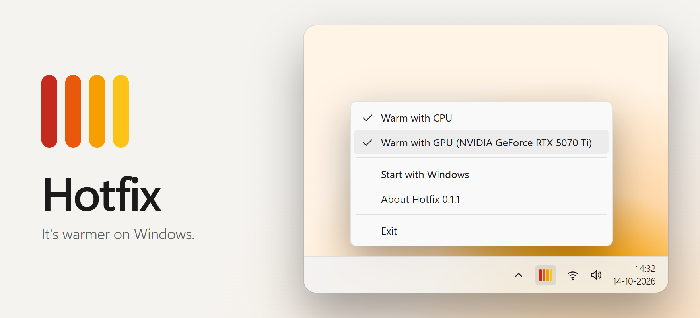

<p align="center">
  <picture>
    <source media="(prefers-color-scheme: dark)" srcset="docs/img/readme-dark.png">
    <source media="(prefers-color-scheme: light)" srcset="docs/img/readme-light.png">
    
  </picture>
</p>

<h1 align="center">Hotfix</h1>

<p align="center">Warms the room with the processor and graphics time your PC isn't using.</p>

<h3 align="center">
  <a href="#-installation">Installation</a> ·
  <a href="https://den-frie-vilje.github.io/hotfix/">Product page</a> ·
  <a href="#%EF%B8%8F-how-it-works">How it works</a> ·
  <a href="https://github.com/den-frie-vilje/hotfix/releases">Release notes</a>
</h3>

<br>

Every watt a PC draws ends up as heat in the room it stands in. Hotfix sits by the clock and turns the CPU and GPU time that nothing else wants into warmth: about 250 watts on the PC it was made on. Your work always goes first. Hotfix runs at the lowest priority Windows has, and turns itself down while you're busy.

Hotfix is Den Frie Vilje's first Windows release.

## 🔥 Features

| | |
|---|---|
| **Warm with CPU** | Keeps your processor busy with arithmetic that never touches memory, so your caches stay yours. |
| **Warm with GPU** | Runs a compute shader on your DirectX 12 graphics card, at the GPU scheduler's idle priority. |
| **Turns down while you work** | Each half's heat follows the room your other apps leave on that part: full while they're quiet, none while they're busy, in proportion in between. |
| **CPU and GPU, each on its own** | Fill the graphics card and the processor keeps you warm. Start a build and the graphics card carries on. |
| **Start with Windows** | One tick in the menu. Off until you choose it. |

## 📦 Installation

> [!NOTE]
> Hotfix runs on 64-bit Windows 11, and on Windows 10 version 1903 (build 18362) or later, on x64 PCs. Warming with the GPU needs a DirectX 12 graphics card. Hotfix is tested on Windows 11 version 25H2.

<details open>
<summary><strong>Install from GitHub [Recommended]</strong></summary>
<br>

1. Download [`Hotfix-win-Setup.exe`](https://github.com/den-frie-vilje/hotfix/releases/latest/download/Hotfix-win-Setup.exe) from the latest release.
2. Open it. Hotfix installs for you only, without asking for an administrator, and starts.
3. If Windows shows **Windows protected your PC**, select **More info**, then **Run anyway**. The installer isn't code-signed yet, so Microsoft Defender SmartScreen hasn't met it.

Hotfix then appears in the Start menu, and in `Settings` > `Apps` > `Installed apps`.

</details>

<details>
<summary><strong>Portable</strong></summary>
<br>

Download [`Hotfix-win-Portable.zip`](https://github.com/den-frie-vilje/hotfix/releases/latest/download/Hotfix-win-Portable.zip), extract it anywhere and open `Hotfix.exe`. Nothing is installed. Hotfix keeps its settings in the registry under `HKEY_CURRENT_USER\Software\Den Frie Vilje\Hotfix`.

</details>

<details>
<summary><strong>Build from source</strong></summary>
<br>

You need the [.NET 10 SDK](https://dotnet.microsoft.com/download/dotnet/10.0).

```powershell
git clone https://github.com/den-frie-vilje/hotfix
cd hotfix
dotnet run --project src/Hotfix
```

[RELEASING.md](RELEASING.md) describes how the installer is built.

</details>

## 🎛️ Use Hotfix

Hotfix lives in the notification area, at the right-hand end of the taskbar. Its icon is four radiator fins, and it works as a gauge: the more fins in colour, the harder Hotfix is warming. All four grey means it's off or has stood down for you. If you can't see the icon, select **Show hidden icons** (**^**) next to the clock.

Select the icon with either mouse button to open the menu:

| Menu item | What it does |
|---|---|
| **Warm with CPU** | Turns the CPU half on or off. |
| **Warm with GPU** | Turns the GPU half on or off, and names the graphics card Hotfix uses. |
| **Start with Windows** | Starts Hotfix when you sign in. |
| **About Hotfix** | Opens the product page in your browser. |
| **Exit** | Stops Hotfix until you start it again. |

Point at the icon to see how hard each half is working, for example *Hotfix: CPU 40%, GPU 100%; turned down while you work*.

To uninstall Hotfix, go to `Settings` > `Apps` > `Installed apps`, select **…** next to Hotfix, then select **Uninstall**. Its Start with Windows entry and its settings go with it.

## ⚙️ How it works

Hotfix gets out of your way twice over, separately for the processor and the graphics card.

- **By priority, at once.** Its CPU threads run at idle priority, below everything else on your PC, and it asks the Windows GPU scheduler for the idle priority class. When your work wants a core or the graphics card, it gets it.
- **By turning down, within half a second.** Priority alone isn't enough, because a chip that is kept hot clocks lower and spends its turbo budget, so your build would still run slower. Twice a second Hotfix reads how busy your other apps keep the processor and the graphics card, from the same counters Task Manager shows. Each half then warms in proportion to the room that's left: fully while other apps use less than 10 per cent of the processor or 5 per cent of the graphics card, not at all above 35 and 40 per cent. The heat drops at once when your work picks up, and climbs back over ten seconds when it eases.

The CPU half runs eight chains of AVX fused multiply-adds on each processor thread it uses. They keep the floating-point units busy without touching memory. The GPU half runs a compute shader that does the same on every core of the graphics card, in slices of a few milliseconds.

Both compute x × ½ + 2⁻¹²⁶, which settles on 2⁻¹²⁵ and stays there, so every multiply-add returns exactly the number it was given. That is as close to nothing as a calculation of its kind can settle while every value stays a normal float, and smaller, subnormal numbers would slow the chips down and make less heat. Den Frie Vilje Research [explains how it was found](https://den-frie-vilje.github.io/hotfix/#research), and [the answer check](tests/AnswerCheck/Program.cs) holds the shipped code to it:

```powershell
dotnet run --project tests/AnswerCheck -c Release
```

### What it costs you

On the PC Hotfix was made on, a Dell Pro Max Tower T2 with an Intel Core Ultra 7 265K and an NVIDIA GeForce RTX 5070 Ti, Hotfix adds about 140 W of package power and 110 W of graphics board power above idle. Single-thread work ran no slower with Hotfix warming than without it.

[The yield check](tests/YieldCheck/Program.cs) measures the cost on your own PC. It times a single-thread job, an all-core job and a GPU job at normal priority, first with Hotfix off and then after Hotfix has warmed the room for a minute, and fails if any of them slows by more than 10 per cent. Exit Hotfix and any heavy apps first, then run:

```powershell
dotnet run --project tests/YieldCheck -c Release -- "$env:LOCALAPPDATA\Hotfix\current\Hotfix.exe"
```

## 🛣️ Roadmap

- **Hotfix 2: compute for climate science.** Lend the same watts to volunteer climate research through BOINC, with Hotfix still in charge of when they are spent. [#1](https://github.com/den-frie-vilje/hotfix/issues/1)
- **Hotfix 3: warm while the grid is cheap and clean.** Your own price and carbon thresholds, from Energinet's Energi Data Service in Denmark. [#2](https://github.com/den-frie-vilje/hotfix/issues/2)

## ✨ What's new

The [release notes](https://github.com/den-frie-vilje/hotfix/releases) list what changed in each version.

## Contributing

Issues and pull requests are welcome. If you change how Hotfix yields, run the yield check before and after, and put both tables in the pull request. If you change what it computes, the answer check must still pass, and the research post must still be true.

## Privacy statement

Hotfix collects no data and makes no network connections. **About Hotfix** opens the product page in your browser, which is the only time Hotfix points anywhere outside your PC.

## Licence

[MIT](LICENSE). © 2026 [Den Frie Vilje ApS](https://denfrievilje.dk).
